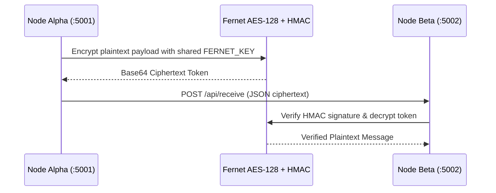

# 🔐 Secure P2P Web Messaging (AES-128 Fernet)


A dual-node peer-to-peer (P2P) encrypted web messaging application built with **Python**, **Flask**, and **`cryptography.fernet`**. It demonstrates authenticated symmetric encryption (**AES-128-CBC + HMAC-SHA256**), RESTful node-to-node communication, and tamper detection.

---

## 🏗️ P2P Communication Architecture



---

## ✨ Key Features

- **Authenticated Symmetric Encryption:** Uses `cryptography.fernet` (`AES-128-CBC` with `PKCS7` padding and `HMAC-SHA256` message authentication) so payloads are never transmitted in plaintext.
- **Environment-Isolated Key Management:** Loads `FERNET_KEY` and `SECRET_KEY` strictly from `.env` via `python-dotenv`.
- **Dual-Node P2P Topology:** Runs two independent Flask instances (**Node Alpha** on port `5001` and **Node Beta** on port `5002`) exchanging encrypted packets over `/api/send`, `/api/receive`, and `/api/inbox`.
- **Cryptographic Tamper Detection:** Automatically rejects altered ciphertexts or mismatched keys with `InvalidToken` verification alerts.

---

## 🗂️ Project Structure

```text
Secure-Messaging-App/
├── templates/
│   └── index.html           # Real-time P2P chat interface
├── .env.example             # Environment variable template
├── app.py                   # Flask P2P node server & Fernet encryption endpoints
├── requirements.txt         # Python dependencies
├── LICENSE                  # MIT License
└── README.md                # Project documentation
```

---

## 🚀 Getting Started

### 1. Clone & Install Dependencies
```bash
git clone https://github.com/Firatdondar/Secure-Messaging-App.git
cd Secure-Messaging-App
pip install -r requirements.txt
```

### 2. Configure Environment Key
```bash
cp .env.example .env
```
*(Generate a fresh 32-byte URL-safe Base64 Fernet key if needed:)*
```bash
python -c "from cryptography.fernet import Fernet; print(Fernet.generate_key().decode())"
```

### 3. Launch Both P2P Nodes
```bash
# Terminal 1 — Node Alpha (Port 5001)
python app.py 5001

# Terminal 2 — Node Beta (Port 5002)
python app.py 5002
```
Open `http://127.0.0.1:5001` and `http://127.0.0.1:5002` in your browser to exchange encrypted messages.

---

## 📄 License

Distributed under the **MIT License**. See [`LICENSE`](LICENSE) for details.
